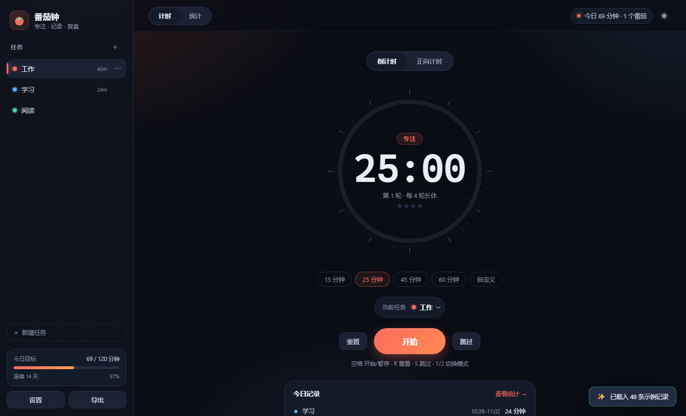
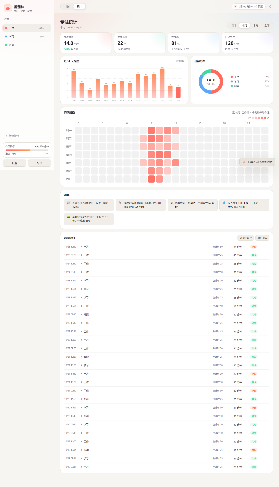

# 番茄钟 · Pomodoro

一个**零依赖、纯本地**的番茄钟：多任务计时、倒计时 / 正向计时、番茄循环，以及专注记录的汇总与可视化分析。



## 直接使用

- **单文件版**：双击 [`番茄钟.html`](番茄钟.html)，离线可用，也可以直接发给别人。
- **源码版**：用浏览器打开 [`pomodoro/index.html`](pomodoro/index.html)，功能完全一致。

数据保存在浏览器 `localStorage`，不会上传到任何服务器。清理浏览器数据或换设备前，请在「设置 → 数据」导出 JSON 备份。

## 功能

- **多任务**：新建 / 改名 / 换色 / 删除任务，侧栏显示每个任务今天的投入；历史记录保留当时的名称与颜色。
- **倒计时**：15 / 25 / 45 / 60 分钟预设或自定义时长，走完自动进入短休 / 长休（默认每 4 轮长休）。
- **正向计时**：不限时长，结束时按实际时长入账。
- **可靠计时**：基于真实时间戳，切后台、锁屏、刷新页面都不会走偏，刷新后可恢复进行中的计时。
- **统计**：今日 / 本周 / 本月 / 全部；专注时长、完成番茄、完成率、日均专注；14 天柱状图、任务占比环图、高效时段热力图、自动洞察、记录明细与 CSV 导出。
- **其他**：深浅主题、移动端自适应、提示音 / 系统通知、JSON 导入导出、快捷键。



## 开发

```
番茄钟.html            单文件构建产物
pomodoro/
  index.html           页面结构
  styles.css           样式与主题
  app.js               计时、任务、统计、导入导出
  build.mjs            构建单文件版本
  preview/             截图
  README.md            完整使用说明与统计口径
```

修改源码后重新生成单文件版：

```bash
node pomodoro/build.mjs
```

## 文档

详细功能说明、快捷键、统计口径与自定义方式见 [pomodoro/README.md](pomodoro/README.md)。

## License

[Apache-2.0](LICENSE)
